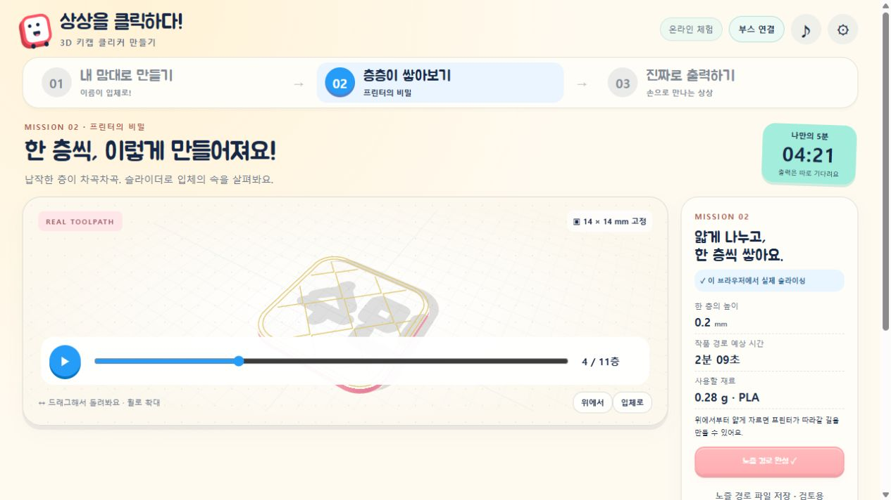

# 2026-10-20 배포 완료 확인

확인 시각: 2026-10-20 13:04 KST. 웹 기능 기준 커밋 **a504c61**, 인수인계·운영자 묶음 보완 **f237c5e**입니다. 이 기록을 추가한 문서 커밋은 별도로 이어집니다.

- [공개 체험 사이트](https://hichoni.github.io/3d-modeling/)
- [집에서 이어가기 / 인수인계](HANDOFF.md)
- [구현 구조·실물 시험이 남은 범위](WEB_FIRST.md)
- [최신 운영자 ZIP](https://hichoni.github.io/3d-modeling/downloads/booth-setup.zip)

## 배포와 코드 검사

| 확인 | 결과 / 근거 |
| --- | --- |
| GitHub main 업로드 | a504c61 → f237c5e push 완료 |
| Pages 빌드·배포 | [39367500599](https://github.com/hichoni/3d-modeling/actions/runs/39367500599), f237c5e, success |
| Windows 격리 빌드·검사 | [39367501412](https://github.com/hichoni/3d-modeling/actions/runs/39367501412), f237c5e, success |
| 자동 검사 | 실제 웹 엔진·중계기 포함 29개 통과 |
| 공개 HTML | 최신 로컬 파일과 SHA-256 일치 |
| 공개 운영자 ZIP | 최신 로컬 파일과 SHA-256 일치 |
| 공개 사이트 기능 시험 | 브라우저에서 ‘수민’ 실제 슬라이싱: 11층, 경로 약 2분 09초, 약 0.28g |

HTML SHA-256: `520b9d18270853d169e69d670afe7e346ae7d3602947783e41df9cb3b6d4a38d`

ZIP SHA-256: `f776a1e08a87eca6533518d2fb1be00c891156313a2a3d2dfc0da349b8283dc6`

공개 주소에서 직접 버튼을 눌러 확인한 화면입니다. 아래 수치는 모델 경로만의 예상값으로 예열·보정·퍼지 시간/재료는 제외합니다.

## 배포 범위

이번에 배포한 것은 **웹 슬라이싱 기능과 현장 중계기 코드·운영자 ZIP**입니다. Microsoft Store 제출·서명·학교 PC 설치 성공을 의미하지 않습니다. 학교의 앱 제어 차단은 우회하지 않았습니다.

프린터 IP가 없는 격리 서버에서 웹 경로 → 3MF → 매칭 → 대기표 → 운영자 검토를 확인했습니다. 새 웹 엔진으로 실제 프린터를 시작한 횟수는 **0회**입니다. 새 파일의 A1 mini 실물 출력, 글자·받침 결합, 학교 ChromeOS와 6대 동시 현장 시험은 다음 작업입니다.

## 집에서 확인할 핵심

공개 페이지의 두 번째 단계에서 ‘이 브라우저에서 슬라이싱!’이 보이고 계산되면 새 웹입니다. 프린터 연결 없이도 됩니다. 실제 출력 접수에는 최신 **중계기 API v5**가 필요하므로 운영자 폴더를 업데이트하고 서버를 다시 시작해야 합니다. 자세한 실행·업데이트·비공개 설정 보존 방법은 HANDOFF.md에 남겼습니다.
