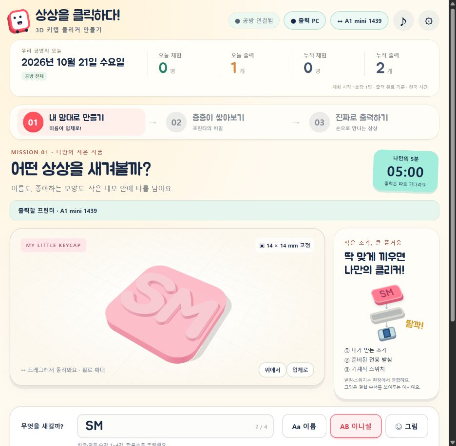

# 2026-10-21 변경·집계·배포 기록

기준 시간대: Asia/Seoul. 이 문서는 대기표 없는 출력, 3D 안내, 상단 집계를 함께 배포하는 기록이다.

- [체험 사이트](https://hichoni.github.io/3d-modeling/)
- [최신 공방 ZIP](https://hichoni.github.io/3d-modeling/downloads/booth-setup.zip)
- [다른 PC에서 이어가기](HANDOFF.md)

## 바뀐 동작

1. 출력 화면의 **바로 출력**을 누르면 선택한 A1 mini로 전송한다. 대기표 발급·번호 전달·개별 운영자 승인 단계를 제거했다. 연결된 미니가 한 대면 자동 매칭한다.
2. 빈 베드·텍스처 PEI·0.4mm 노즐·외부 PLA 준비 안내를 버튼 곁에 둔다. 실제로 출력하는 버튼이다. 베드 레벨링·유량 보정을 켜고 시작하며 첫 층은 현장에서 살핀다.
3. Three.js 설명 모형에서 베드·노즐·필라멘트를 강조하고 시점과 말풍선을 자동으로 넘긴다. 실제 온도·목표 온도·준비·층·일시정지·완료를 함께 표시한다. 모형의 움직임은 원리 설명용이며 실제 모터 좌표가 아니다.
4. 원리 미리보기는 예시 온도로 표시하고 프린터 시작 명령을 보내지 않는다. 멈추기·이어보기·다시 보기와 움직임 감소 설정을 지원한다.
5. 부스 연결 화면에서 LAN 액세스 코드를 직접 저장하고 인증·실시간 상태까지 확인한다. 코드를 메모장으로 편집할 필요가 없다.
6. 웹 슬라이싱 v2의 윗면 5겹·좁은 틈 채움·압출량 보정, 누적 레이어 표시, int32 작업 ID와 100% 완료 표시를 포함한다.

## 날짜와 집계 기준

상단에 한국 날짜·요일, 오늘 체험 인원·완료 출력 수, 누적 체험 인원·완료 출력 수를 표시한다.

- **인원은 체험 시작 횟수 기준이다.** 첫 디자인 조작 또는 단계 이동 때 1회 기록한다. 이름이나 실제 사람을 식별하지 않는다. 같은 체험의 새로고침·수정·슬라이싱·전송 재시도는 인원을 늘리지 않는다.
- **새 작품 만들기 / 처음부터 → 새로 시작하기**는 다음 체험을 연다. 같은 작품 다시 준비로 재출력하는 것은 새 인원으로 세지 않는다.
- **출력 수는 완료된 작품 기준이다.** 준비·전송·출력 중·실패·취소는 늘리지 않는다. 같은 작업은 완료 보고가 반복돼도 한 번만 센다.
- 한국 시간 자정에 오늘 숫자만 바뀌고 누적 숫자는 유지된다. 날짜와 집계는 15초 간격으로 갱신하며 새 체험과 완료 때도 갱신한다.
- 공방 연결 시 여러 기기의 기록을 중계기에 합쳐 **공방 전체**로 표시한다. 연결하지 않은 Pages/HTML은 **이 기기** 합계다. 이것을 인터넷 전체 방문자 통계로 표시하지 않는다. 미연결 체험 기록은 나중에 공방에 연결할 때 중복 없이 합친다.
- 과거에는 체험 시작 기록이 없었으므로 이전의 실제 사람 수를 복원할 수 없다. 인원 기록은 이번 기능 적용 시점부터 쌓인다.
- 기존 완료 출력은 작업 기록에서 복원한다. 새 작업은 기기 완료 보고를 받은 `completedAt`을 쓴다. 이전 작업은 완료 증거 시각, 그 값이 없으면 완료 상태로 저장된 파일의 수정 시각을 이관 기준으로 사용한다. 시각이 없는 기록은 누적에만 포함한다.

실제 보관 기록 복원 결과: **2026-10-21 오늘 출력 1개, 누적 출력 2개**. v1과 v2가 각각 별도 완료 작업이다. 이 배포 작업은 새 실물 출력을 시작하지 않았다. v2 표면 품질과 받침 결합에 대한 사용자 확인은 남아 있다.

## 저장·중복 방지·업데이트

- 중계기: 비공개 `runtime/statistics.json`. SHA-256으로 변환한 임의 체험 ID와 시작 시각, 완료 작업 ID·시각만 보관한다. API 응답은 합계뿐이며 이름·접근 코드·원문 체험 ID를 돌려주지 않는다.
- 브라우저: `click-statistics-v1`, `click-experience-v1`에 이 기기의 체험 기록을 보관한다. 같은 체험 ID로 재시도하거나 재연결해도 한 번만 합산한다.
- `POST /api/experiences`는 공방 접근 권한·같은 origin·CSRF·기기 토큰을 검사한다. 최대 50개 배치와 날짜·ID를 검증하고 파일을 원자적으로 교체한다.
- 기존 출력의 소유자·매칭 버전·파일 SHA·실제 일련번호·최신 상태·SD·노즐·한 프린터 한 작업·중복 시작 방지를 유지한다.
- 최신 중계기는 API v6이다. Pages는 정적 화면이므로 공방 전체 집계·프린터 연결에는 최신 중계기를 함께 사용한다. 기존 폴더를 갱신할 때는 출력이 끝난 뒤 서버를 종료하고 **runtime 전체를 백업·보존**한다. 공개 파일만 바꾸고 다시 실행한다. 통계·작업·매칭·비밀 설정을 새 기본 파일로 덮어쓰지 않는다.
- 공개 ZIP과 Windows payload 모두 새 런타임 모듈을 포함하며, 실제 프린터 설정·통계 원문·작업 파일·검증용 가상 통신 모듈은 배포 묶음에 넣지 않는다.

## 검증

- node scripts/build.cjs 성공. node --test tests/*.test.cjs: **47개 통과, 실패 0개**. git diff --check 통과.
- 집계 검사: 한국 자정 전후, 누적 보존, 새로고침/재시도/다른 기기의 중복 ID, 재시작 복원, 과거 완료 이관, 실패 작업 제외, 저장 실패 시 미확인 기록 미반영, CSRF·기기 토큰·합계 공개 범위.
- Chromium 격리 UI: 체험 인원 0 → 첫 입력 1 → 새로고침·수정 후 1 → 다음 체험 2. 실제 프린터에 명령을 보내지 않았다.
- 실제 공방: 기존 완료 2개 복원과 날짜·집계 표시를 확인했다.

## GitHub 배포 확인

확인 시각: 2026-10-21 00:50:46 KST. 기능 커밋 **045b2afa1434c1d4945252c2b1b32885ee4b7c72**를 main에 업로드했다. 이 절의 배포 결과는 후속 문서 커밋으로 보완한다.

| 항목 | 결과 |
| --- | --- |
| GitHub main 업로드 | 045b2af push 완료 |
| Pages 빌드·배포 | [39451552378](https://github.com/hichoni/3d-modeling/actions/runs/39451552378) · success |
| Windows 격리 빌드·앱 검사 | [39451553806](https://github.com/hichoni/3d-modeling/actions/runs/39451553806) · success |
| 로컬 자동 검사 | 47개 통과 · 실패 0 |
| 공개 HTML | HTTP 200 · 로컬 SHA-256과 일치 |
| 공개 운영자 ZIP | HTTP 200 · 로컬 SHA-256과 일치 |
| 공개 Chromium 실행 | 날짜·오늘/누적 카운터·실제 슬라이싱·3D 노즐 설명 확인 · console error 없음 |

공개 사이트에서 수민 양각 0.8mm를 계산해 11층, 작품 경로 약 2분 20초, 작품 재료 약 0.34g을 확인했다. 이 수치는 준비·퍼지·보정 시간과 재료를 포함하지 않는다. 공방에 연결하지 않은 공개 페이지의 카운터는 이 기기 기준으로 0 → 1이 됐다. 실제 프린터에 새 출력 명령은 보내지 않았다.

HTML SHA-256: `9e7d4985071f04d27566f515c4c40b87fbff6e7c38c4517439456c533d83f9de`

ZIP SHA-256: `a3915ccdf7d9426e90bb80084d3eadb260ecc75229a3f438610a3ac64bcda0cc`

실제 설정값과 비공개 경로가 공개 파일 및 ZIP에 포함되지 않았는지 업로드 전에 검사했고 일치 항목은 0개였다. runtime·work·실제 통계 파일·작업 파일은 공개하지 않았다.
