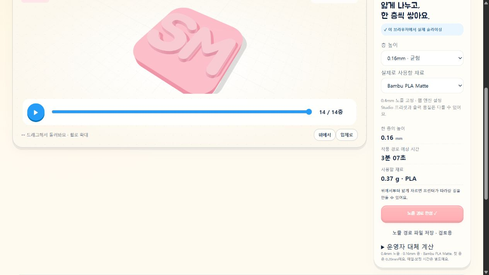
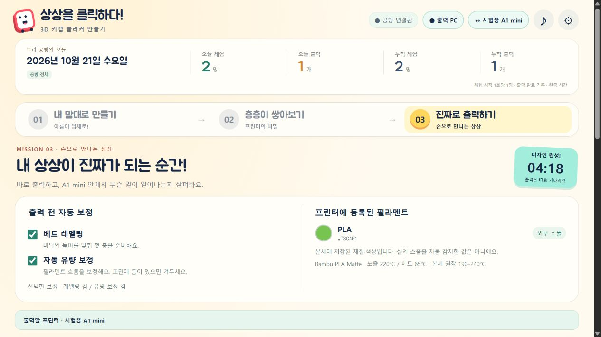

# 출력 전 설정과 웹 품질 프리셋 — 2026-10-21

## 화면과 실제 출력 명령

- 출력 화면에서 **베드 레벨링 / 자동 유량 보정**을 각각 켜고 끈다. 기본값은 모두 켬이다. 같은 브라우저·프린터의 선택을 저장한다.
- 바로 출력을 누르는 순간 선택을 복사해 작업에 저장한다. 전송·출력 중에는 잠그며, 재전송으로 옵션을 바꾸거나 출력 명령을 중복 발행하지 않는다.
- 중계기는 boolean 두 개만 허용하며 `project_file.bed_leveling`, `project_file.flow_cali`로 보낸다. 시작 G-code의 `g29_before_print_flag`, `extrude_cali_flag` 조건부 블록은 유지했다. 체크 해제로 전체 메시 보상이나 필수 가열·홈 동작을 삭제하지 않는다.
- 출력 시작 전 보정은 재료별 압출 비율을 무작정 늘리는 기능과 다르다. 사진의 빈틈을 베드 레벨링 하나로 단정하지 않는다.

## 프린터 재료 정보

최신 MQTT 보고의 `vt_tray`에서 외부 스풀의 PLA/PETG 같은 종류, RGBA 색상, 노즐 권장 온도 범위를 표시한다. AMS가 보고되면 슬롯 목록과 사용 중인 슬롯을 읽기 전용으로 보여준다. RFID·일련번호·접근 코드 등 원문 응답은 공개하지 않는다. 연결이 오래되면 이전 색상을 현재 정보처럼 표시하지 않는다.

**외부 스풀의 색상·종류는 본체에 등록된 값이다. 실제 재료를 센서로 식별했다는 뜻이 아니다.** 실제 연결 읽기에서는 외부 PLA와 흰색 등록값이 보고됐다. 사용자의 초록색 실물 사진을 근거로 프린터 등록값을 자동 수정하지 않았다. UI 검수 그림의 초록색은 격리된 가짜 프린터 fixture 값이다.

현재 출력은 **외부 PLA·0.4mm 노즐·텍스처 PEI** 전용이다. 보고된 외부 재질이 PLA가 아니거나 AMS 재료가 사용 중이면 시작을 막는다. 파일 업로드 뒤에도 다시 확인한다. AMS 선택·자동 라우팅·PETG 프로필·본체 재료 설정 쓰기는 추가하지 않았다.

## 웹 프리셋

슬라이싱 화면에서 층 높이와 실제 사용할 재료를 고른다. 설정을 바꾸면 기존 경로·준비 파일을 무효화하고 다시 계산한다. 프린터에 보낸 파일의 설정은 완료 후에도 원래 값으로 표시한다. 같은 디자인 다시 준비로 새 계산을 시작할 수 있다.

| 웹 선택 | 이후 층 높이 | 첫 층 | 윗면 / 바닥 |
| --- | --- | --- | --- |
| 정밀 | 0.12mm | 0.20mm | 5 / 5겹 |
| 균형 | 0.16mm | 0.20mm | 6 / 4겹 |
| 표준 | 0.20mm | 0.20mm | 5 / 3겹 |

공통: 선폭 0.42mm, 외벽 2줄, 격자 15%, 노즐 220°C·베드 65°C, 재료 유량 비율 0.98. 첫 층의 압출 단면은 0.20mm 기준으로 따로 보정한다. 브라우저와 중계기가 선택한 층 간격·첫 층·높이·재료량·명령 범위를 각각 검사한다.

| 재료 선택 | 냉각 팬 상한 | 최소 층 시간 | 웹 유량 상한 |
| --- | --- | --- | --- |
| Generic PLA | 100% | 4초 | 12mm³/s |
| Bambu PLA Matte | 80% | 6초 | 12mm³/s |

**Bambu Studio와 동일한 품질이라고 인증하지 않는다.** 설치된 공식 프리셋을 상속까지 펼쳐 비교했다. 온도·유량 비율·선폭·첫 층·일부 층 수는 맞췄지만 Kiri의 벽/채움 알고리즘, 가속·이동·냉각 처리는 다르다. 공식 Matte의 유량 상한은 22mm³/s이지만 웹은 기존 검증 범위인 12mm³/s를 유지한다. 0.08mm·강도·노즐 지름 변경 프리셋은 이번 범위에 없다.

공식 비교 자료: [A1 mini PLA Matte](https://github.com/bambulab/BambuStudio/blob/master/resources/profiles/BBL/filament/Bambu%20PLA%20Matte%20%40BBL%20A1M.json), [PLA Matte 공통값](https://github.com/bambulab/BambuStudio/blob/master/resources/profiles/BBL/filament/Bambu%20PLA%20Matte%20%40base.json), [0.20mm Standard](https://github.com/bambulab/BambuStudio/blob/master/resources/profiles/BBL/process/0.20mm%20Standard%20%40BBL%20A1M.json). 비교에 사용한 설치본의 값과 추후 master 값이 달라질 수 있다.

## 글씨 빈틈과 실물 피드백

사용자는 v2 실물 사진에서 전반적인 표면이 좋아졌으나 S 획과 M 꺾이는 부분에 빈틈이 남는다고 보고했다. 실제 출력한 SM STL의 윗면 삼각형을 확인했으며 글씨 형상 자체에 그 구멍은 없었다.

v3에서는 Kiri 채움과 벽의 접합부 겹침을 15%에서 엔진 기본값인 35%로 늘렸다. 이 수치는 Studio의 infill-wall overlap과 기하학적 의미가 같지 않다. 전역 유량을 추가로 올리지 않았다. 기존 thin-fill 처리는 유지했다. 0.12mm 선택만으로 가로 방향 빈틈이 자동 해결된다고 안내하지 않는다.

같은 SM 윗면을 0.06mm 격자로 표본화하고, 압출량에서 추정한 비드 폭으로 경로를 덮었을 때 경로 가장자리에서 0.04mm 넘게 떨어진 표본이 257/17,486에서 115/17,486으로 줄었다. 최대 거리는 약 0.158→0.118mm였다. 이는 이상적인 비드를 가정한 **경로 진단값**이며 실물 기공률·강도·표면 합격 판정이 아니다.

같은 14×14×2.1mm SM 모델의 v3 계산:

| 설정 | 층 수 | 작품 경로 예상 | 작품 재료 |
| --- | --- | --- | --- |
| 0.12mm / Matte | 17 | 약 3분 37초 | 0.341g |
| 0.16mm / Matte | 13 | 약 3분 08초 | 0.363g |
| 0.20mm / Matte | 10 | 약 2분 35초 | 0.337g |
| 0.20mm / Generic | 10 | 약 2분 29초 | 0.337g |

위 예상은 예열·퍼지·레벨링·유량 보정 시간/재료를 제외한다. 같은 모델을 설치된 Bambu Studio의 PLA Matte·0.20mm Standard로 별도 계산한 결과는 준비 포함 약 7분 49초·0.492g으로, 서로 시간/재료의 범위가 다르므로 속도나 사용량의 우열로 비교하지 않는다. 이 참조 파일을 프린터에 보내지 않았다.

v3 실물의 글씨 채움·실 끌림·치수·받침 결합은 후속 확인이 필요하다. 이번 작업에서는 새 물리 출력을 시작하거나 가열하지 않았다.

## 검증과 배포

- `node tools/slicer/build.cjs`, `node scripts/build.cjs` 성공. 고정된 upstream은 수정하지 않았다. 빌드 기록에 프리셋 소스 해시도 포함한다.
- `node --test tests/*.test.cjs`: **54개 통과·실패 0개**.
- 3개 층 높이 × 2개 재료가 실제 엔진으로 계산되고 3MF로 포장됨을 검사했다. 첫 층의 E/mm가 기존 기준을 유지함도 확인했다.
- 네 가지 보정 조합의 실제 전송 payload, 전송 도중 옵션 변경 거부, 중복 클릭, 잘못된 값, 재질 불일치, stale 값 숨김, 원문 비밀 정보 제외를 검사했다.
- 격리 Chromium: 체크 해제 → 새로고침 후 유지 → 가짜 프린터 시작 → 두 값 모두 false로 작업에 저장·조작 잠금 → 완료 → 같은 디자인 재계산을 확인했다. 실제 프린터와 연결된 서버에는 시험 인원·시험 출력 수를 추가하지 않았다.
- 실제 중계기 **API v7**로 갱신하고 A1 mini 상태 연결을 다시 확인했다. 구버전 중계기로 새 옵션을 조용히 무시하지 않도록 웹에서 업데이트를 요구한다. 기존 runtime 전체를 보존한다.
- 공개 ZIP과 Windows payload의 허용 목록에 새 런타임 모듈과 공통 프리셋을 넣었다. runtime·작업 STL·개인 설정·격리 통신 fixture는 배포하지 않는다.

상태 재확인 시 이미 동일 IP·일련번호·인증으로 연결되어 있고 보고가 최신이면 그 연결을 유지한다. 자격 증명이 바뀌거나 보고가 오래된 경우는 기존 discovery·인증서 검증을 다시 거친다. 이 동작도 격리 검사에 포함했다.

## GitHub 배포 확인

기능 커밋 `a32e1d3e32f3b19514d5f33870cd3a27e9159912`, 연결 보완 커밋 `4826bb2ef10473af856023c60a9260f1157c6d86`을 main에 업로드했다. 이 절은 그 기능 파일의 배포 검증을 후속 문서 커밋으로 기록한다.

| 항목 | 확인 결과 |
| --- | --- |
| Pages 빌드·배포 | [39506689387](https://github.com/hichoni/3d-modeling/actions/runs/39506689387) · success |
| Windows 앱 빌드·MSIX·격리 시작/종료/UI 검사 | [39506690767](https://github.com/hichoni/3d-modeling/actions/runs/39506690767) · success |
| 자동 검사 | 54개 통과·실패 0 |
| 공개 HTML / ZIP | 모두 HTTP 200·아래 SHA-256과 일치 |
| 공개 Chromium | 0.16mm·Bambu PLA Matte로 수민 양각 계산: 14층·작품 약 3분 04초·0.37g. console error 0 |
| 실제 중계기 | API v7·A1 mini online/fresh·FINISH·오류 없음·외부 PLA/흰색 등록값 수신 |
| 비공개 값 검사 | 공개 변경 파일 및 ZIP 압축 해제 내용의 실제 접근 코드·IP·일련번호·PIN 일치 0 |

HTML SHA-256: `8221cd25426b3546465e0b53f88c8542dda71d2d454c9ecc05c0955283bf7d76`

ZIP SHA-256: `4827a3a834f26c095d47c49ce23da3e16b1d0d1773a93b60052de7841c0b5360`

Windows 산출물은 기존과 같은 미서명 검토용 패키지다. Store 정식 출시는 하지 않았다. 실제 프린터 출력·가열 없이 검증했으며, v3 실물 품질은 아직 확인 전이다.
