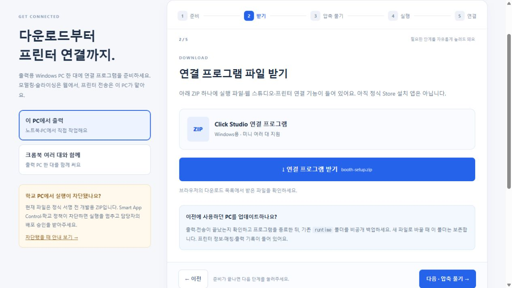

# 연결 프로그램 다운로드·실행·프린터 연결 안내 · 2026-10-21

## 사용자 흐름

[setup.html](https://hichoni.github.io/3d-modeling/setup.html)에 5단계 안내를 추가했다. 스튜디오 ‘프린터 연결 → 이 PC에서 출력 → 연결 프로그램 받기 · 5단계 설정’과 기존 부스 처음 설정, README에서 연다.

1. 준비: 공식 Node.js 24 LTS Windows 64비트 MSI. 다른 PC 종류는 공식 다운로드 페이지로 안내.
2. 받기: 운영자 ZIP 직접 다운로드와 기존 runtime 백업·보존 안내. 요청을 누르는 것만으로 다운로드·설치 완료를 표시하지 않는다.
3. 압축 풀기: Windows ‘모두 추출’과 click-workshop 폴더 그림·실제 파일명.
4. 실행: 이 PC 전용은 start-workshop.cmd, 크롬북 함께 쓰기는 configure-booth.cmd. 미니 대수만 입력하고 공유 모드에서 출력 PC 주소를 추가 확인한다. IP/SN/코드는 웹에서 입력한다.
5. 연결: 실행한 PC의 studio.html#connect=1 새 탭 → 연결 창 자동 열기 → 미니 선택 → 검색 → 본체 8자리 코드 → 연결 확인 → 사용하기. 함께 쓰기는 운영자 PIN·참가자 링크 복사 순서까지 안내한다.

진행 위치·선택 모드만 브라우저에 보관한다. 파일 실행·설치 여부를 자동 판정하거나 공개 웹에서 localhost를 탐색하지 않는다. 크롬북에는 프로그램을 설치하지 않는다. 실행 차단 시 별도 설명 화면으로 전환하고 학교 배포 승인을 요청한다. 정식 Store 앱이나 SAC 문제 해결로 표시하지 않는다.

## 구현과 검증

- src/setup.html/css/js → 단독 setup.html. 외부 실행 스크립트·글꼴 요청 없음. 공개 Pages·미리보기·연결 프로그램·ZIP/native payload에 포함.
- bridge/setup.cjs --web: 기존 인증 정보·이름·ID·PIN·선택 대체 슬라이서·공유 키를 유지하면서 빈 슬롯을 추가. 초기 IP/SN/Bambu Studio 질문을 생략. CLICK_RUNTIME로 격리 검사가 가능하다.
- configure-booth.cmd는 --booth --web, 배경 실행은 -Studio로 연결 화면을 연다. 구버전 실행 중이면 재시작을 요구하며 자동으로 중단하지 않는다.
- ZIP의 먼저 읽어주세요.txt는 docs/OPERATOR_QUICK_START.txt에서 생성한다. 실제 실행 흐름과 안내를 함께 갱신한다.
- 전체 자동 검사 **72개 통과**. 가상 서버에서 페이지 단계·모드·차단 화면과 마지막 링크의 연결 창 자동 열기를 확인했다. 실제 학교 실행 차단 파일을 실행하거나 프린터 명령을 보내지 않았다.
- 공식 MSI URL은 HTTP 200, application/x-msi 응답을 확인했다. 설치 파일을 PC에 설치·실행하지는 않았다. Node.js 최신 LTS 표시는 [공식 다운로드 페이지](https://nodejs.org/en/download), 압축 해제 방법은 [Microsoft 안내](https://support.microsoft.com/en-us/windows/experience/storage-filemanagement/zip-and-unzip-files)를 확인했다.

## 배포

기능 커밋 `0c9a44cb19b5d786483c0c3255b866c193dce71c`을 main에 반영했다. 2026-10-21 공개 페이지와 다운로드를 확인했다.

- [Pages 배포 성공](https://github.com/hichoni/3d-modeling/actions/runs/39534301697).
- [Windows 검사 성공](https://github.com/hichoni/3d-modeling/actions/runs/39534303017): 전체 웹·중계기 검사, native 앱·MSIX 빌드, 격리 앱 시작/종료·UI 렌더링, 검토용 패키지 생성. 정식 서명·Store 공개 완료를 의미하지 않는다.
- 공개 스튜디오에서 ‘프린터 연결 → 연결 프로그램 받기 · 5단계 설정’으로 실제 안내 페이지에 진입했다. 공개 다운로드 단계의 ZIP 링크와 콘솔 오류 없음도 확인했다.
- 로컬 가상 서버에서 5단계 전환·PC/크롬북 모드별 실행 파일·차단 안내·마지막 링크의 연결 창 자동 열기를 확인했다. 실제 프린터나 차단된 프로그램은 실행하지 않았다.
- 아래 4개 공개 파일은 HTTP 200이며 로컬 파일과 SHA-256이 일치했다. ZIP 내부의 안내 파일·setup.html 일치도 검사했다. 화면 증거를 포함한 최종 배포 감사에서 157개 공개 파일에 runtime/artifacts/work 경로와 알려진 비공개 인증 정보가 포함되지 않음을 확인했다.

| 공개 파일 | SHA-256 |
| --- | --- |
| index.html | `97a5ae90773a097dd14450453724562cbfd52ec32e2bd1e599e5d64f1b4bf9f8` |
| studio.html | `ea1cf90bca54953f65d7671d7b48727838492e25a54a3a6084295b1adbd3a895` |
| setup.html | `e9a28084e6040b646ca5d0acf57a8b4fb4ff8d2bc08c0e81fd5aeca02b9704bf` |
| downloads/booth-setup.zip | `d1a6bca85b2a8491db24dded0078c37944737494c054809155a6ecd432f44e23` |

실제 학교 PC의 설치 승인, 학교 Wi-Fi 검색·6대 동시 운영, ChromeOS 정책은 별도 현장 확인이 필요하다. 브라우저 UI 검증은 데스크톱 화면에서 진행했으며 작은 모바일 화면 실측 검증은 하지 않았다. 현재 ZIP은 서명 전 개발용이고, Smart App Control 차단 문제와 Store 등록은 미완료다. 보안 기능을 끄거나 차단된 프로그램의 실행을 우회하지 않는다.
