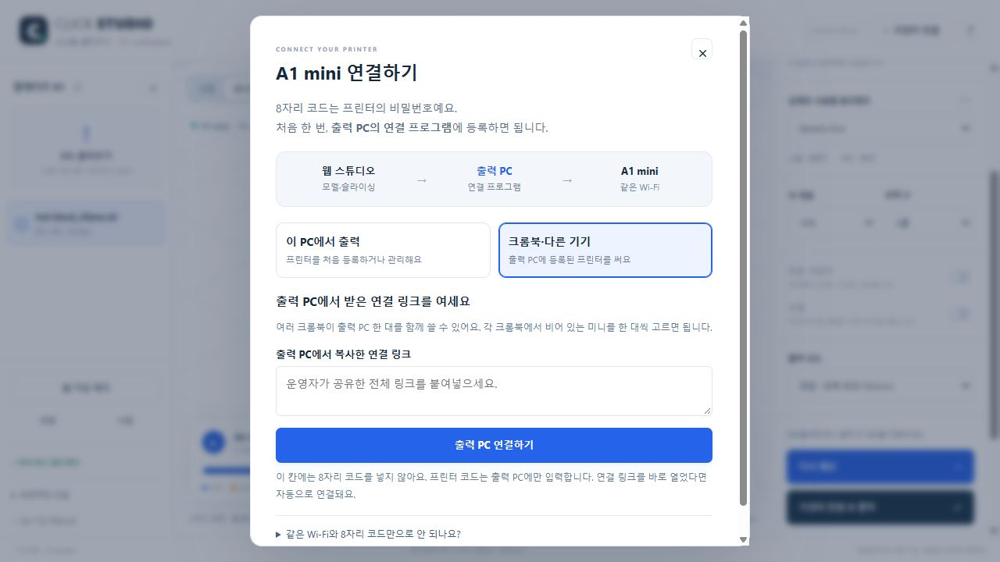

# STL 가져오기 오류 · 쉬운 프린터 연결 · 2026-10-21

## 수정한 문제

1. 한 개의 영면만 있어도 STL 전체를 거절하던 가져오기를 수정했다. 면적이 정확히 0인 면만 제외하며 원본 파일을 덮어쓰지 않는다. 유효 면까지 합치던 1e-4 모서리 반올림 진단도 제거했다. 닫힌 도형의 접합은 경고로 보여주고, 열린/홀수 모서리는 출력 준비에서 계속 거절한다.
2. 여러 윤곽이 층마다 바뀌는 모델에서 엔진이 실행되지 않는 보조 worker를 기다리던 문제를 고쳤다. 고정 upstream을 바꾸지 않고 빌드 어댑터에서 풀 크기를 0으로 고정했다.
3. 모호한 ‘부스/공방 연결’ 화면을 기기별 안내로 바꿨다. 출력 PC에서는 연결 프로그램 실행 → 프린터 찾기/선택 → 8자리 코드 등록, 크롬북에서는 출력 PC의 연결 링크 → 미니 선택이다. 같은 Wi-Fi만으로 공개 웹이 프린터에 직접 전송하지 못한다는 이유도 설명한다.
4. 출력 PC 전용 읽기 전용 SSDP 검색을 추가했다. 자동 입력은 IP/SN만이며 코드 저장·TLS/기기 확인·출력 시작은 기존 명시적 동작과 검사를 유지한다. 다중 프린터 1:1 매칭을 바꾸지 않는다.

## 확인한 것

- 전체 자동 검사 **68개 통과**. 영면·미세 면·열린/접합 모서리, 여러 경사 도형의 실제 슬라이싱 회귀, 링크/코드 구분, 가짜 UDP 검색·필터·자원 해제·로컬 전용·CSRF 등을 추가했다.
- 사용자 제공 STL은 원본 48,738면, 약 80×44.31×14.31mm. 브라우저에서 열림을 확인했다. 동일 worker로 서포트 켬·72층·3MF 검증이 통과했다. 작품 경로 약 1시간 29분·10.68g, 준비 동작은 별도.
- 가상 프린터 UI에서 검색 → 선택 → IP/SN 자동 입력 → 가상 8자리 코드 등록·상태 확인까지 성공했다. 실제 MQTT/FTPS·검색 소켓은 fixture로 대체했다.
- 원본·개인 식별 파일명·출력 3MF와 비공개 프린터 값은 공개하지 않았다. 실제 프린터를 움직이거나 기존 비공개 runtime을 변경하지 않았다.

실제 Wi-Fi에서 자동 검색이 보이는지, 큰 모델의 부착·서포트·종료 동작·품질은 현장 시험이 필요하다. 정식 Store 서명/설치 정책은 이 수정으로 해결된 것이 아니다.

## 배포

기능 커밋 [`7292d682f203a1fcd6e3acefcaaedfd26514b4ee`](https://github.com/hichoni/3d-modeling/commit/7292d682f203a1fcd6e3acefcaaedfd26514b4ee). [Pages 배포](https://github.com/hichoni/3d-modeling/actions/runs/39530127834)와 [Windows 전체 검사·MSIX 빌드·격리 앱 실행](https://github.com/hichoni/3d-modeling/actions/runs/39530128535) 모두 성공했다. 이 빌드는 정식 Store 서명이 아니다.

공개 스튜디오에서 두 연결 안내·모바일 폭 390px·60층 실제 계산·콘솔 오류 없음을 확인했다. 공개 HTML·운영자 ZIP 모두 HTTP 200 및 로컬 SHA-256 일치:

| 파일 | SHA-256 |
| --- | --- |
| index.html | `c0ba30b8becc73f6446819bfc07ce2c82675187c02519454073b3b1f12952b82` |
| studio.html | `dde91ea94db3f67ac52a40833d2c51a7b0db4dcd4b6f56a9a49709c7ba689088` |
| downloads/booth-setup.zip | `cff2e4fefb42c2bf3d93a844d683b58d9e81f0bbe6135e821fd0dbd3db351d8f` |

