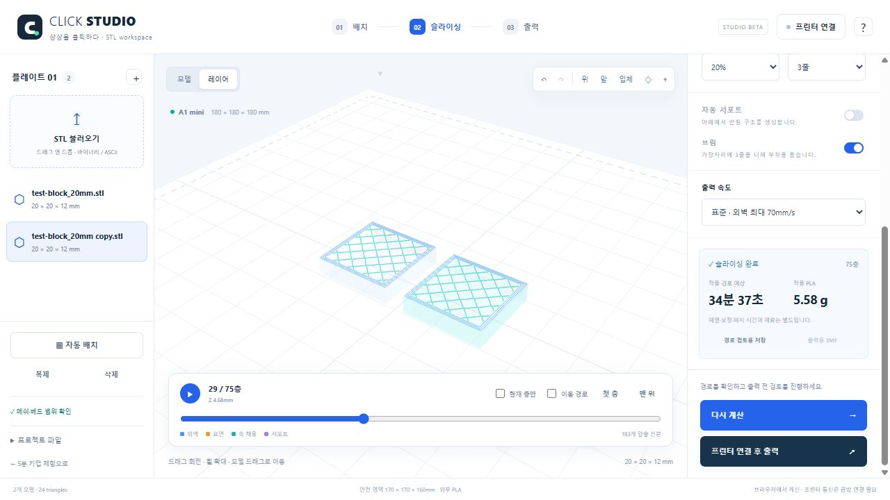

# Click Studio STL 스튜디오 배포 · 2026-10-21

## 결과

[공개 STL 스튜디오](https://hichoni.github.io/3d-modeling/studio.html)를 기존 [14mm 체험](https://hichoni.github.io/3d-modeling/)과 별도로 추가했습니다. 일반 STL 배치·크기·회전·복제·자동 배치·프로젝트 저장, 실제 웹 슬라이싱, 채움/벽/서포트/브림/속도, 레이어 경로, 소유한 3MF 저장, 기존 1:1 미니 매칭과 출력 검토를 제공합니다.

중계기는 API v8로 올렸습니다. 출력 PC는 최신 [운영자 ZIP](https://hichoni.github.io/3d-modeling/downloads/booth-setup.zip)으로 갱신해야 새 스튜디오 출력 준비가 됩니다. Bambu Studio는 기본 계산·전송 경로에 필요하지 않습니다. 중계기가 없는 공개 웹은 STL 편집·계산·검토까지 동작합니다.

## 검증

- Node 자동 검사 62개: 기존 54개와 STL 파서·변환·배치·실제 worker·자동 서포트·160mm 종료 상승·서버 재검증·3MF/해시·소유자 격리·중복 시작/중지 검사.
- 브라우저: STL 업로드, 150% 균일 확대·90도 회전·복제·두 모델 자동 배치, 0.16mm/20%/브림 실제 계산 187층. 초기 마지막 층 미리보기 확인.
- 가상 프린터: 5193의 격리 MQTT/FTPS fixture에서 1:1 매칭 → 준비 → 두 확인 항목 → 전송 → 출력 중 → 완료를 확인. 실제 기계에는 명령을 보내지 않음.
- 프로젝트 JSON과 작업 소유자의 출력용 3MF 다운로드 확인. 800px/390px 반응형과 가로 넘침 점검. 콘솔 오류 없음.
- 공개 주소에서 샘플 두 개를 0.16mm/채움 20%/벽 3줄/브림으로 계산: 75층, 작품 경로 34분 37초·5.58g. 29층의 실제 속 채움, 첫 층/현재 층/이동 경로 표시를 확인. 공개 페이지 콘솔 오류 없음.
- 비공개 runtime 값 3개와 공개 텍스트·ZIP 내용을 대조해 일치 없음. runtime/work/artifacts가 공개 파일 목록에 포함되지 않음.

## 미완료 범위

새 STL 조합의 큰 모델·서포트·동적 종료 동작은 실물 시험 전입니다. 지원 범위는 170×170×160mm, 6개/6MB/12만 삼각형, A1 mini 0.4mm 외부 PLA·텍스처 PEI입니다. 트리 서포트·메쉬 자동 수리·AMS·다른 재료/기종/노즐은 지원하지 않습니다. 학교 ChromeOS·6대 동시 운영, Store 서명/출시는 별도입니다.

기존 SM v3 14mm 실물 완료 기록은 [HANDOFF.md](HANDOFF.md)에 유지했습니다. 최신 STL 작업과 혼동하지 않습니다. 프린터 설정·runtime은 수정하지 않았습니다.

## 배포 확인

기능 커밋: [`832301449efcdc2a192d83e8921b28bbee73d089`](https://github.com/hichoni/3d-modeling/commit/832301449efcdc2a192d83e8921b28bbee73d089).

[Pages 배포](https://github.com/hichoni/3d-modeling/actions/runs/39524113443) 성공. 2026-10-21 09:55 KST 공개 파일 모두 HTTP 200, 로컬 SHA-256과 동일:

| 파일 | SHA-256 |
| --- | --- |
| index.html | `4ce72692891277c2e50472af2532fd229d8332d47ab63158ea52f287de7a59a7` |
| studio.html | `2550d3dbffa885c0345e05eda7fd4a2484d4ec24f7ea818781b9aefa11ebc8f3` |
| downloads/booth-setup.zip | `53585fbfb0a9d7610381e7d83047c0bdf17cee925f3bf63e23a00049f5da107c` |

[Windows 검사](https://github.com/hichoni/3d-modeling/actions/runs/39524113940)도 최종 성공했습니다. 웹 전체 검사, native/MSIX 빌드·검증, 격리된 앱 시작/종료·UI 검사가 포함됩니다. 패키지는 여전히 미서명 검토용이며 Store 출시를 뜻하지 않습니다.

로컬 검증용 미리보기 5186과 가상 프린터 서버 5193은 검사 후 종료했습니다. 기존 실제 프린터 중계기를 실행하거나 비공개 설정을 바꾸지 않았습니다.

