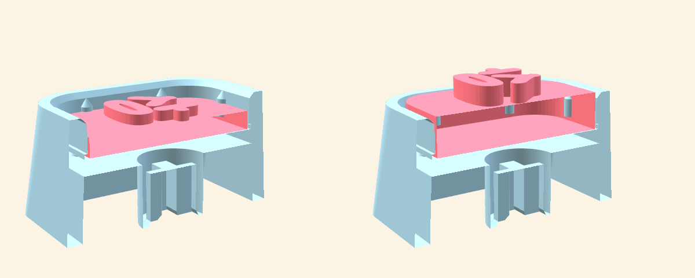
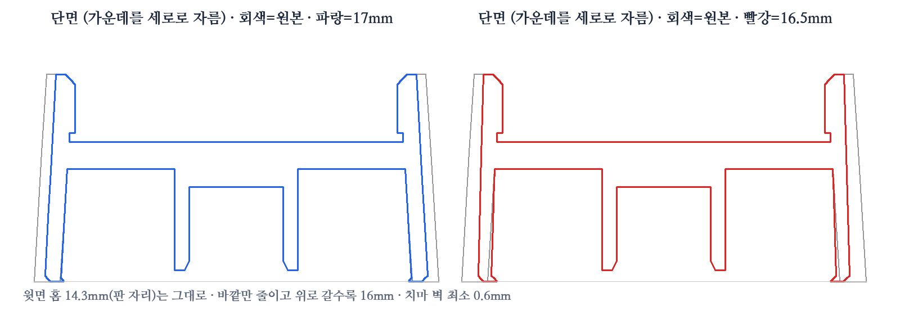

# 키캡 밑판 · 스위치 결합부 길이 조절

`keycap-base-original.stl`은 받은 키캡 밑판(18×18×9.2mm, 윗면 14.3mm 홈 깊이 약 2.9mm, 윗판을 밀어 빼는 구멍 2개)입니다. 아래의 십자 결합부(5.5mm 사각 기둥, 십자 4.16×1.24mm)는 원래 스커트 바닥(Z=0)까지 내려오고 십자 구멍 깊이가 약 4.2mm입니다.

| 파일 | 결합부 아래쪽을 줄인 길이 | 십자 구멍 깊이 | 키캡 위치 |
| --- | --- | --- | --- |
| `keycap-base-socket-0.5.stl` | 0.5mm | 약 3.7mm | 0.5mm 낮게 · MX 십자(약 3.6mm)를 거의 다 물어요 **(추천)** |
| `keycap-base-socket-1.0.stl` | 1.0mm | 약 3.2mm | 약 0.6mm 낮게 · 십자 끝이 구멍 천장에 닿아 멈춤 |
| `keycap-base-socket-1.5.stl` | 1.5mm | 약 2.7mm | 약 0.6mm 낮게 · 무는 길이가 짧아 덜 단단 |

원본처럼 입구에 0.2mm 깔때기(0.4mm 높이)를 다시 만들었습니다. 결합부가 스커트 바닥보다 위에서 끝나므로 **스커트 바닥을 베드에 두고 출력하면 결합부 아래에 서포트**가 필요해요(슬라이서의 자동 서포트 · "빌드 플레이트에서만"으로 충분).

`python3 models/keycap-base/shorten_socket.py 0.8` 처럼 원하는 길이로 다시 만들 수 있어요.

## 도장으로 쓰려면

부스의 **입체 방향 → 🔖 도장**을 고르면 윗판이 바닥 3.0mm + 글자 1.5mm(전체 4.5mm)로 바뀌고 글자가 좌우 반전됩니다. 윗판을 밑판 홈(약 2.9mm)에 끼우면 글자가 테두리보다 약 1.5mm 위로 올라와, 인주를 찍을 때 테두리는 묻지 않고 글자만 찍혀요. 기본(볼록·오목) 윗판은 1.5mm + 글자 0.6~1mm라 테두리보다 낮습니다.

## 바깥을 줄인 키캡 (보관함·다른 끼움 자리가 빡빡할 때)

윗면의 **판 끼우는 홈 14.3mm는 그대로**라 부스에서 뽑은 14×14mm 판이 똑같이 끼워져요. 바깥만 줄였어요(둘 다 소켓 0.5mm 버전 기반).

| 파일 | 바닥 바깥 | 맨 위 바깥 | 치마 벽 | 홈 둘레 벽 |
| --- | --- | --- | --- | --- |
| `keycap-base-socket-0.5.stl` (원본) | 18.0mm | 16.9mm | 1.2mm | 약 1.3mm |
| `keycap-base-socket-0.5-outer17.stl` | **17.0mm** | 16.0mm | 약 0.7mm | 0.9mm |
| `keycap-base-socket-0.5-outer16.5.stl` | **16.5mm** | 16.0mm | 0.6mm | 0.9mm |

- 위로 갈수록 좁아지는 모양과 둥근 모서리는 원본처럼 유지하고, 바닥 모서리는 0.25mm 깎아 첫 층이 퍼져도 치수를 넘지 않아요.
- 16.5mm는 치마 벽이 0.6mm보다 얇아지지 않게 치마 안쪽 아래의 벌어진 부분을 조금 메웠어요(스위치 들어가는 공간이 한쪽 최대 약 0.15mm 좁아짐). **먼저 17mm로 맞춰 보고**, 그래도 빡빡하면 16.5mm를 쓰세요.
- `python3 models/keycap-base/slim_outer.py 16.8`처럼 원하는 바닥 크기로 다시 만들 수 있어요.
