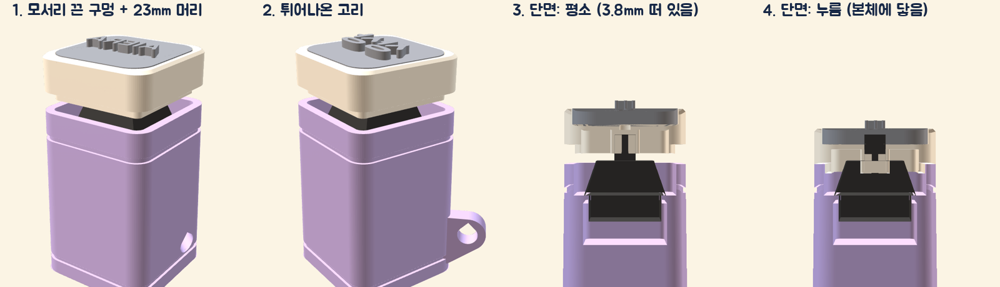

# 큰 도장 머리 (23mm 키캡 + 20mm 이름판)

키캡 밑판(18mm, 윗판 14mm) 대신 **본체 윗면과 같은 23×23mm** 머리를 씌워, 윗면 도장 글자를 **20×20mm 판**에 크게 새깁니다(14mm 판보다 면적 약 2배).

| 파일 | 내용 |
| --- | --- |
| `stamp-head-23.stl` | 머리(키캡). **뒤집힌 채로 저장**돼 있어 그대로 출력(윗면이 베드, 서포트 없음 · 판 홈 바닥만 브리지) |
| `stamp-plate-20-sangsang.stl`, `-aiera.stl` | 시험용 이름판 20×20 · 바닥 3.0 + 글자 1.5(좌우 반전 = 찍으면 바르게) |
| `stamp_head.py` | 위 파일을 만드는 스크립트(치수는 맨 위 상수) |

## 구조 (mm)

- 머리 바깥 23×23(모서리 R3.35, 본체 윗면과 같음) · 높이 8.5 · 윗면 홈 20.3×20.3 깊이 2.9 · 판 빼는 구멍 Ø2.2 두 개
- 아래 치마 19×19 → 본체의 19.6mm 우물에 들어가므로 **이미 뽑은 본체 그대로** 씁니다
- 십자 결합부는 기존 밑판과 같은 규격(5.5mm 기둥, 십자 4.16×1.24, 깊이 3.7, 입구 깔때기)
- 가만히 있을 때 머리 아랫면이 본체 윗면에서 **3.8mm** 떠 있고, 누르면 스위치가 끝까지(4mm) 내려가기 직전에 **본체에 닿아 멈춰요**. 도장 찍는 힘이 스위치가 아니라 본체로 갑니다.

## 부스 연결

지금 부스는 14×14mm 판만 만들어요. 이 머리를 쓰려면 부스에서 20×20mm 판(도장 모드)을 만들 수 있어야 합니다.
