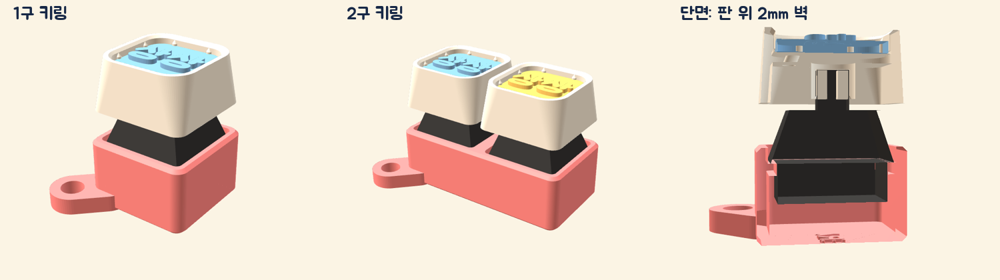

# 키캡 키링 (1구 · 2구)

부스에서 만든 **14×14mm 이름판**을 키캡 밑판(18mm)에 끼우고, 기계식 스위치를 이 낮은 케이스에 꽂아 키보드처럼 딸깍 누르는 키링입니다. 도장 본체(`models/keychain`)보다 훨씬 작고 납작해요.

| 파일 | 크기 (mm) |
| --- | --- |
| `keycap-keychain-1.stl` | 1구 · 19.05×19.05×12.1 (고리 포함 25.3×25.3) |
| `keycap-keychain-2.stl` | 2구 · 38.1×19.05×12.1 (고리 포함 44.3×25.3) |
| `compact_case.py` | 위 파일을 만드는 스크립트(치수는 맨 위 상수) |

- 스위치 판 위로 **2mm 벽**이 스위치마다 둘러싸요(구멍 16.2mm). 키캡 아래 틈이 평소 약 5.4mm, 끝까지 눌렀을 때 약 1.4mm로 줄고, 키캡은 벽에 닿지 않아요.
- 키 간격은 키보드와 같은 **19.05mm**라, 18mm 키캡 두 개 사이가 약 1mm 떨어져요.
- 스위치 판은 도장 본체와 같은 규격(구멍 14.05mm, 두께 1.5mm)이라 `models/keychain/switch-fit-test.stl`로 맞는 구멍을 먼저 확인할 수 있어요.
- 판 아래에 스위치 아랫몸과 핀(판 아래 6.8mm)이 들어갈 7.4mm 공간이 있고, 바닥은 1.2mm(아래에 AIERA 0.4mm 음각)예요.
- 고리는 한쪽 아래 모서리에서 대각선으로 튀어나온 납작한 탭(두께 3, 구멍 Ø4.2)이에요.
- 출력: 바닥이 베드로(파일 그대로), 서포트 없음. 스위치 판 테두리는 1mm 정도만 안쪽으로 튀어나와 그대로 뽑혀요.

`python3 models/keycap-keychain/compact_case.py`로 다시 만들 수 있어요. 필요한 패키지: `pip install manifold3d trimesh fonttools mapbox_earcut`.
