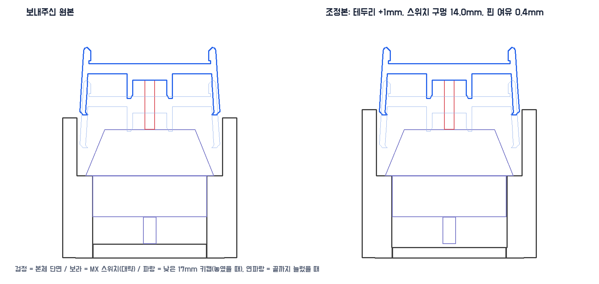
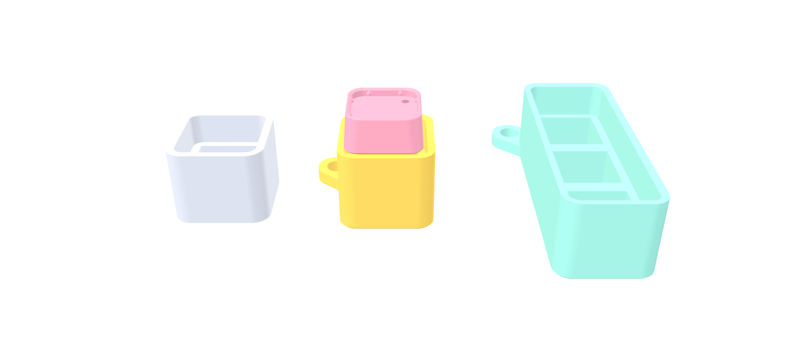
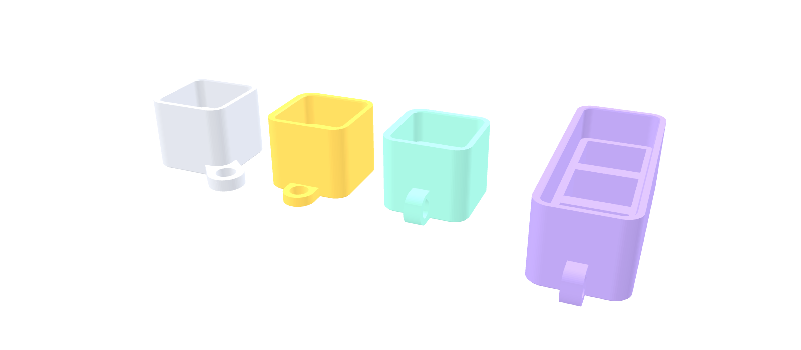
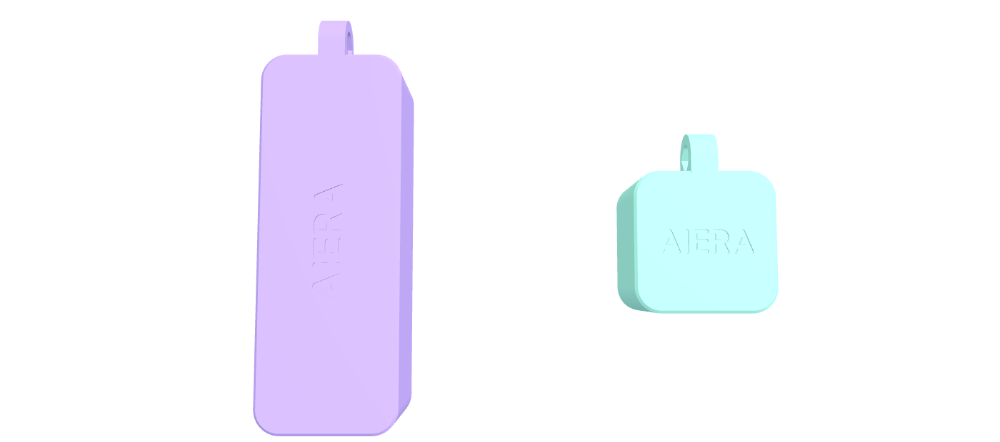
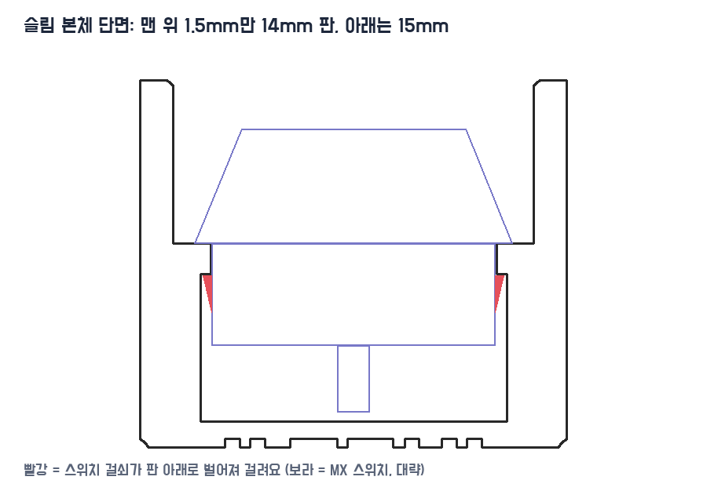

# 키캡 키링 본체 1·2·3구 (키캡을 감싸는 테두리형)

받은 본체(`holder-N-original.stl`)를 MX 스위치·17mm 둥근 키캡(`models/keycap-base/*-outer17.stl`)에 맞게 점검하고 조정했어요(`holder-N.stl`).

## 점검 결과 (원본)

| 부분 | 치수 | 판단 |
| --- | --- | --- |
| 스위치 구멍 | 13.89×13.80mm (2·3구 13.80×13.88), 1.66→10.0mm | MX 판 구멍 규격 14.0mm보다 0.1~0.2mm 작아요. 출력하면 더 줄어 스위치가 빡빡하게 눌려 들어가요 |
| 스위치 걸림턱 | 10.0mm 높이 (윗몸이 올라앉는 곳) | 맞아요. 걸쇠가 걸리는 1.5mm 판은 없고 구멍 벽 마찰로 잡아요 |
| 구멍 깊이 | 8.3mm (바닥 1.66mm) | MX 아랫몸 5mm + 핀 3.3mm와 딱 같아서 핀 끝이 바닥에 닿아요 |
| 테두리 | 안쪽 17.65mm, 10→17mm(7mm) | 17mm 키캡이 한쪽 0.33mm 여유로 들어가요. 18mm 원본 키캡은 안 들어가고, 16.5mm는 헐거워요 |
| 키 간격 | 17.5mm | 17mm 키캡 사이 0.5mm. 키보드 간격(19.05)보다 촘촘해요 |
| 벽 두께 | 테두리 1.75mm, 키링 구멍 쪽 2.5~2.65mm, 아래쪽은 스위치 둘레 3.6~4.6mm 통짜, 바닥 1.66mm | 튼튼하지만 키링 쪽과 아래 몸통은 필요보다 두꺼워요 |
| 메쉬 | 닫힌 모델. 2·3구는 안쪽에 두께 없는 겹친 면이 있음 | 출력에는 문제없어요. 조정본은 깔끔한 모델로 다시 만들었어요 |

키캡이 놓였을 때 키캡 아래 끝이 걸림턱 위 약 7.4mm(스위치 축 끝 11.6mm − 키캡 십자 구멍 천장 4.2mm)에 와요. 원본 테두리(17mm)보다 0.4mm 높아서, 가만히 있을 땐 테두리가 키캡을 감싸지 않아요.

## 조정본 `holder-1.stl` · `holder-2.stl` · `holder-3.stl`

- **테두리 1mm 높임** (17 → 18mm): 놓였을 때도 키캡 아래쪽 약 0.6mm를 감싸고, 눌렀을 때는 약 4.6mm를 감싸요. 테두리의 곧은 구간을 늘린 거라 모양은 그대로예요.
- **스위치 구멍 14.0×14.0mm**: 각 구멍 가운데를 기준으로 MX 규격에 맞췄어요.
- **핀 여유 0.4mm**: 스위치 아래 바닥을 0.4mm 더 파서 핀이 닿지 않게 했어요(바닥 1.26mm).
- 키링 구멍, 바깥 모양, 키 간격은 원본 그대로예요.

`python3 models/keychain-holder/tune_holder.py`로 다시 만들 수 있어요(맨 위 상수 RIM_UP·TUBE·PIN_ROOM).

## 슬림 본체 `holder-1-slim.stl` · `holder-2-slim.stl` · `holder-3-slim.stl`

조정본과 같은 맞춤(테두리 안쪽 17.65mm·18mm 높이, 걸림턱 10mm, 스위치 구멍 14.0mm, 바닥 1.26mm, 키 간격 17.5mm)을 깔끔하게 다시 만들고 두꺼운 곳을 줄였어요.

- **벽 1.6mm로 고르게**: 원본은 두 면 1.75mm, 키링 쪽 두 면 2.5~2.65mm였어요. 본체가 22mm → **20.85mm**, 2·3구는 길이도 약 1mm 짧아져요. 모서리는 테두리 안쪽과 같은 결로 둥글어요(R3.8).
- **키링 탭 구멍 지름 5mm**: 원본은 지름 약 3mm 구멍이 모서리를 대각선으로 꺾여 지나가서 고리가 잘 안 들어갔어요. 이제 한쪽 아래 모서리에서 대각선으로 나온 납작한 탭(두께 3mm)에 곧게 뚫린 5mm 구멍이라 고리가 바로 끼워져요.
- 바닥 모서리 0.4mm 깎기(첫 층 퍼짐), 테두리 안쪽 윗모서리 0.3mm 경사(키캡이 쉽게 들어감).
- 바닥이 베드로(파일 그대로), 서포트 없이 출력해요. `python3 models/keychain-holder/slim_holder.py`로 다시 만들 수 있어요.

### 고리 방식 고르기

| 파일 | 고리 | 모양 |
| --- | --- | --- |
| `holder-N-slim.stl` | 모서리 탭 | 아래 모서리에서 대각선으로 나온 납작한 탭, 구멍 5mm |
| `holder-N-slim-tab.stl` | **끝면 탭** | 짧은 쪽 가운데에서 일자로 나온 작은 납작한 탭(두께 2.4mm), 구멍 4.5mm |
| `holder-N-slim-loop.stl` | **끝면 고리** | 짧은 쪽 가운데 바닥에 선 작은 반원 고리(폭 4mm), 구멍 4mm가 옆으로 뚫림 |

셋 다 바닥에 붙어 서포트 없이 출력돼요(끝면 고리 구멍은 위쪽이 45°로 뾰족한 물방울 모양이라 처지지 않아요). N은 1·2·3구.

### 바닥 AIERA

슬림 본체 9종 모두 바닥에 **AIERA를 0.4mm 깊이로 새겼어요**. 좌우를 뒤집어 새겨서 뒤집어 봤을 때 바로 읽혀요(1구 가로 · 글자 높이 3.6mm, 2·3구는 길이 방향 · 4.4mm). 글자 밑 바닥은 0.86mm 남아요. 베드에 닿는 면이라 텍스처 판 무늬와 함께 깔끔하게 나와요.

### 스위치 고정 (걸쇠 잠금)

14mm 곧은 구멍은 마찰로만 잡아서 스위치가 헐거웠어요. 슬림 본체 9종은 **키보드 판처럼** 바꿨어요: 걸림턱 바로 아래 **1.5mm만 13.9mm 판**이고, 그 아래는 **15.0mm로 넓어져** 스위치 양옆 걸쇠가 판 아래로 벌어지며 딸깍 걸려요(스위치를 어느 방향으로 꽂아도 돼요). 빼려면 아래에서 밀거나 걸쇠를 눌러요.

그래도 빠져서 **눌림 리브**를 더했어요: 넓은 공간의 네 벽마다 걸쇠가 있는 가운데를 피해 양쪽(가운데에서 ±4.6mm)에 세로 리브가 있고, 스위치 아랫몸(약 13.9mm)을 **13.7mm로 조여요**(바닥에서 5.3~7.9mm 높이, 윗부분 0.6mm는 경사라 밀어 넣으면 들어가요). 출력 오차가 있어도 리브가 살짝 눌리며 꽉 잡아요. 판 구멍도 14.0 → 13.9mm로 줄여 위쪽 흔들림을 없앴어요.

원본 기반 조정본(`holder-N.stl`)은 모서리 키링 터널이 스위치 구멍 바로 옆을 지나 넓힐 자리가 없어서, 구멍만 **13.9mm**로 살짝 좁혀 마찰을 늘렸어요(원본 13.8mm는 빡빡, 14.0mm는 헐거움).
