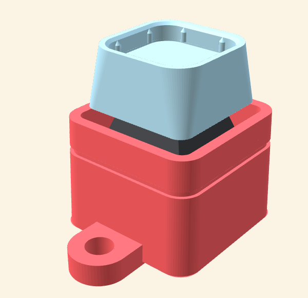

# 도장 키링 본체 (키캡 + 기계식 스위치용)

부스에서 만든 14×14mm 윗판을 꽂은 **키캡 밑판**을 기계식 키보드 스위치에 끼우고, 그 스위치를 이 본체에 꽂아 열쇠고리로 씁니다. 바닥은 **도장 면**이라 인주를 묻혀 찍으면 테두리와 `AIERA`가 하얗게 나옵니다(음각).

| 파일 | 내용 |
| --- | --- |
| `keychain-body.stl` | 본체 · 바닥 도장 면(테두리 + AIERA 음각 0.8mm) |
| `keychain-body-plain.stl` | 본체 · 바닥 민무늬 |
| `switch-fit-test.stl` | 스위치 끼움 시험판 1.5mm(13.95 / 14.05 / 14.15mm 구멍, 홈 1·2·3개) — 먼저 뽑아 보면 좋아요 |
| `keychain_body.py` | 위 파일을 만드는 스크립트(치수는 맨 위 상수) |

## 치수 (mm)

- 본체 24×24(위 23×23, 살짝 좁아지는 도장 모양) × 높이 18.5, 고리 탭 포함 세로 32.5
- 스위치 판: 구멍 **14.05×14.05**, 두께 **1.5**(MX 계열 스위치 클립 규격) — 판 아래 16×16×8 공간(스위치 아랫몸·클립·핀 6.8mm)
- 키캡 우물: **19.6×19.6**, 깊이 6 — 키캡 밑판 18×18이 눌릴 때 2.5mm 정도 본체 안으로 들어가요(가만히 있을 땐 테두리보다 1.5mm 위)
- 바닥 도장 면 두께 3, 고리 구멍 Ø4.2(탭 두께 3.5)

받은 키캡 밑판 STL을 재 보니 바깥이 **18×18mm**(아래 18 → 위 16.9, 높이 9.2), 윗면 홈이 14.3×14.3(깊이 2.8)입니다. 23×23으로 보였던 건 대각선(약 25mm)이나 다른 부품일 수 있어요. 키캡이 더 크면 `WELL`(우물 크기)만 키우면 됩니다.

## 출력

- 방향: **도장 면이 바닥**(파일 그대로), 서포트 없음
- A1 mini · PLA · 0.2mm · 벽 3줄 이상 권장 · 약 25분 · 4.2g(이 스튜디오 기준)
- 스위치가 헐겁거나 안 들어가면 `switch-fit-test.stl`로 맞는 구멍을 고른 뒤 `CUTOUT` 값을 바꿔 다시 만드세요.

## 조립

1. 스위치를 본체 위에서 구멍에 "딸깍" 소리 날 때까지 눌러 끼워요(핀은 아래 빈 공간에 들어가요).
2. 윗판을 꽂은 키캡 밑판을 스위치 축에 끼워요.
3. 고리 구멍에 열쇠고리 링을 걸어요. 스위치를 뺄 때는 스위치 풀러로 위·아래 클립을 집어 빼요.

치수는 일반적인 MX 규격(판 구멍 14.0, 판 두께 1.5, 판 위 하우징 15.6)을 기준으로 했어요. 미리보기 속 검은 스위치는 확인용 대략 모형입니다.
